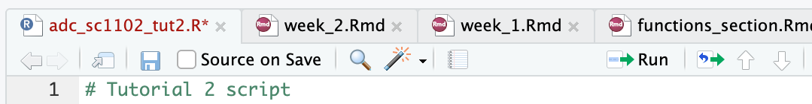
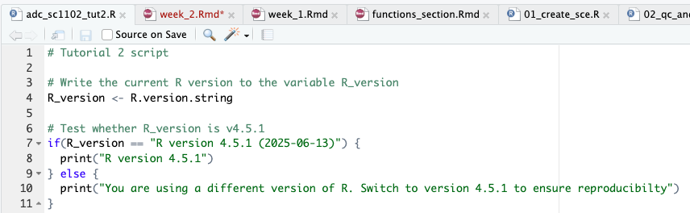

```{r setup, include=FALSE}
knitr::opts_chunk$set(echo = TRUE)
```

[&larr; Back to the SC1102 course page](../)

## Welcome back to R ##
This week we are tackling ``reproducibility!``. 

What is reproducibility I hear you ask? 

Great question! Reproducibility is the ability to reproduce a set of results given an input dataset and an well defined set of methods. In science, there aren't many concepts more important than reproducibility. If you conduct a bunch of analyses or experiments to obtain a set of results, but the next person to attempt what you did can't do so because either the initial input data is missing or corrupted, or the methodology by which you obtained your results is incomplete or inaccurate, you may as well have not done the analysis in the first place. 

The need to publish your methods and workflows in a reproducible way is absolutely critical, but the problem is, it's often incredibly boring and tedious. Luckily for you, we're working in R where producing reproducible code is baked into the fabric of the whole language. Last week we learnt some basic commands in order take in some data, manipulate it and process it but the issue is that what we did can't be easily recreated because it was all written and executed in the console. If I were to ask you right now to reproduce the final plot we created last week, you'd have to write out all the lines of R code again in order to do so. What we need is a way to save our code so that we can execute it on demand, whenever we like with the confidence that we'll end up with exactly the same set of results each time. What we want is automatable, deterministic code.

Before we start writing any code, we should create a new project, as we did last week. Remember, a project will set the working directory and help keep your files organised. Like last week, choose a logical location and name for your project. Create a new folder for your R project.

```{r eval=FALSE}
# !!Remember to change these paths to suit your own directory structure!!

# On Mac or Linux
dir.create("~/Documents/teaching/2026/TR3/SC1102/SC1102_tut2", recursive = TRUE)

# On Windows (keep your work in C:/RWork, outside OneDrive)
dir.create("C:/RWork/SC1102/SC1102_tut2", recursive = TRUE)

```

So today, rather than typing all our code into the console, we are going to build an R script. To launch a new one, click ``File``/``New File``/``R script`` and you'll see it open up in the top left pane of RStudio.

The first thing we typically do is write a comment line at the top with the name of the script and any extra information you'd like to provide users, after which we save it as a ``.R`` file. Last week I briefly mentioned comments but from now on, comments become critical. In case you don't remember, a comment is a line of text or code that is preceded with a ``#`` character. In R, anything following a ``#`` will not be executed which means we can use this symbol to annotate our code in order to make it easier for other users or future versions of ourselves to read. It's much easier to read a line of free text than trying to interpret an often convoluted code base and so we use comments wherever we have code in order to make it clear what the code does and why its there. Today you **must** make sure that **every bit of code you write is thorougly commented!** If you write code, make sure there is a comment above it detailing what it does. The more detail the better. Future you will thank past you for commenting heavily.



See in that first tab I have named my script ``adc_sc1102_tut2.R``. This name tells me who made it (first initials), what subject it was for and which tutorial. Use this same scheme to name your script and then make sure to save it into your project/working directory by clicking ``File``/``Save As``.

The first thing our script is going to do is to check the version of R that it is running on. This is a little pedantic but I'm including it here to reinforce what it means to produce truly reproducible R code. After checking the version of R we are using, the script will then write a a couple of lines that will warn users of our code if they are about to use a different version of R to the one it was initially created with. 99% of the time, if someone has a slightly different version of R, the code will still execute perfectly but occasionally new updates will include changes that alter how code may be interpreted. This can sometimes kill the code outright so that it doesn't execute, or it might alter the type of output produced. Here's the code block:

```{r}
# Check your current version of R
R.version.string

```

For me, the version is 4.5.1, for you probably something else. We're now going to store this string as a variable and execute a block of code to test whether the currently used version is the same or not. Of course here it will be exactly the same but if you were to later try to execute this on another machine, it may not be the case.

```{r}
# Write the current R version to the variable R_version
R_version <- R.version.string

# Test whether R_version is v4.5.1
if(R_version == "R version 4.5.1 (2025-06-13)") {
    print("R version 4.5.1")
} else {
    print("You are using a different version of R. Switch to version 4.5.1 to ensure reproducibilty")
  }

```

What we just did was an ``if-then-else`` statement which is common to many languages. They way it works is you say ``if`` some condition is met, ``then`` do this particular thing, but if it's not true (``else``) then do this other thing. In R, ``then`` is not written explicitly, it's implied by the open ``{`` curly brace.

So to break this down, what the code says is, if your version of R is 4.5.1, that is the output of the ``R.version.string`` command is precisely ``R version 4.5.1 (2025-06-13)``, then print the text ``R version 4.5.1``, however if the output of ``R.version.string`` is anything else, print that long line of text instead. This code will not kill anything, it will just provide the user with the information that they are using a different version of R to the one that was intended by the programmer (you!) and so to proceed with caution.

If you type this code into your R script correctly, it should look something like this:




## Building your script ##

Today we will produce an script that takes in a dataset that you've seen before, performs a bunch of operations on it and then create a few plots. The fun part though is that at the end of this process, we're going to share the script we've written with one of our classmates to see whether or not they can run the code as it was intended, and produce the results exactly as we had done ourselves. If we can achieve this, then we can be sure that we've created reproducible code that will produce a consistent result regardless of who runs it.

First up, the data. We're going to work with the paramecium population growth data you saw in the first section of this course and you can download a copy of this from the [tutorial website](https://acalcino.github.io/SC1102_2026/) under `Datasets`, `Module 5`. As we mentioned last week, directory structure is critically important so make sure you download this file to your `project/working directory`!

**SUPER ULTRA CRITICAL REMINDER HERE!!** This week we are building a script so make sure you do this in the top left panel in your script and not just in the console in the bottom left panel. If you don't create a script and instead just run all these commands in the console then you will have nothing to submit for this section of the portfolio assessment and so you will absolutely not pass!

Now that we have our project and working directory sorted out and the ``Paramecium_aurelia.csv`` placed snugly inside, we can import the dataset into R as the variable `paramecium`.

```{r}
# Import the paramecium growth dataset
paramecium <- read.csv("Paramecium_aurelia.csv")

```

If this doesn't work, it means the paramecium dataset is not in your working directory.

Now we want to produce a simple plot to visualise the data but the issue is, we don't just want to see it in the plot window in RStudio, we also want to save a copy as an image file so that we can look at it later. To do this, we'll first plot our data and then we'll run the command ``dev.copy()`` to copy the contents of the plot window to an image file.

``` {r}
# Produce a simple scatter plot of the data
plot(paramecium$Time..days., paramecium$Paramecium,
     # pch tells it what shape point to plot
     pch = 19,
     xlab = "Time (days)",
     ylab = "Population size (N)",
     main = "Paramecium population growth")

# Save the plot as an image file to our working directory.
dev.copy(png, "paramecium_growth_n_vs_time.png", width = 1600, height = 1200, res = 300)
dev.off()

```

## The modelling cycle ##

Way back in the first lecture of the first section, we were introduced to ``the modelling cycle``:

```
1. Question                 What am I trying to explain, describe or predict?
2. Variables & assumptions  What variables and assumptions matter most?
3. Model construction       How will I represent the system in a model?
4. Results                  What does the model predict?
5. Testability              How could I test whether the model is wrong?
6. Evaluation               Is the model useful for its intended purpose?
7. Interpretation           What have I learned about the original problem?
```

Today we're going to work our way around this cycle using our paramecium data. You've already done all of this in Excel, so none of the biology or the modelling concepts will be new to you. What's new is that we're going to do it in an R script, so that anyone can rerun our entire workflow from start to finish.

## Modelling natural population growth ##

Remember the general framework from the lectures. Next year's population is this year's population, plus natural population growth, minus the harvest:

$$N_{t+1} = N_t + G(N_t) - h$$

Where:

```
N_t+1  = Population size at the next time step (t+1)
N_t    = Population size at this time step (t)
G(N_t) = Natural population growth (which depends on N_t)
h      = Harvest
```

Nobody is harvesting our paramecium (I hope), so ``h = 0`` and the equation becomes:

$$N_{t+1} = N_t + G(N_t)$$

or, if we move ``N_t`` over to the other side, the change in population size from one time step to the next is:

$$\Delta N_t = N_{t+1} - N_t = G(N_t)$$

So what goes into ``G(N_t)``? In our simplified model, it's recruits plus immigrants minus deaths minus emigrants. Our paramecium are living in a sealed little container in a lab, so nobody is moving in and nobody is moving out. That's one of our **assumptions** (step 2 of the modelling cycle!) and it means we're left with:

$$G(N_t) = recruits - deaths$$

The number of recruits is the per capita recruitment rate ``b`` multiplied by the number of individuals, and the number of deaths is the per capita mortality rate ``d`` multiplied by the number of individuals, so:

$$G(N_t) = bN_t - dN_t = (b - d)N_t = RN_t$$

where ``R = b - d`` is the net per capita population growth rate.

One more piece of jargon from the lectures that is about to become very useful. Our model has two kinds of variables:

```
State variables  record the state of the system      here: N
Parameters       drive changes in the state variables  here: b, d (and so R)
```

This distinction maps beautifully onto how we write code. Parameters are values we choose and type in at the top of our script. State variables are what the code calculates for us.

## The geometric model ##

In the previous section you built a geometric growth model in Excel with ``b = 1``, ``d = 0.5`` and ``N0 = 2``. Interestingly, our paramecium population also starts with 2 individuals, so let's start by rebuilding that exact Excel model in R. First up, the parameters.

```{r}
# Per capita recruitment rate (b): new recruits per individual per time step
b <- 1

# Per capita mortality rate (d): fraction of individuals that die per time step
d <- 0.5

# Net per capita population growth rate R = b - d
R <- b - d

# Starting population size N0
N0 <- 2

# Number of time steps we want to run the model for
n_steps <- 10

```

In Excel, you typed the starting population into the first cell and then wrote a formula in the cell below that referred to the cell above it, before dragging that formula down the column. In R, we do the same thing using something called a ``for loop`` which you will have heard about in this week's lecture.

```{r}
# Create an empty numeric vector to hold the population size at each time step.
# We need n_steps + 1 slots because we also need a slot for time 0
N <- numeric(n_steps + 1)

# Put the starting population size into the first slot
N[1] <- N0

# Step the model forward one time step at a time using N(t+1) = N(t) + G(Nt),
# where G(Nt) = R * Nt
for (i in 1:n_steps) {
  N[i + 1] <- N[i] + R * N[i]
}

# Have a look at the result
N

```

A ``for loop`` takes on the structure, for every instance of a variable ``i``, perform the following function. In the case above, our ``for loop`` says, for every integer between 1 and 10, calculate the next population size from the current one and store it in the next slot of ``N``. This is exactly what you did when you dragged your formula down the column in Excel. The only difference is that R counts from 1 rather than 0, so ``N[1]`` holds the population size at time 0, ``N[2]`` holds the population size at time 1, and so on.

Now, in Excel you didn't just have a column of population sizes, you had a whole table with columns for ``Time``, ``N``, ``G(N)``, ``ΔN``, ``b``, ``d`` and ``R``. We can build exactly the same table in R as a dataframe.

```{r}
# Build a table just like the one we made in Excel
geometric_table <- data.frame(
  # Time steps from 0 to n_steps
  Time = 0:n_steps,
  # Population size at each time step
  N = N,
  # Population growth G(N) = R * N
  G_N = R * N,
  # Observed change in N from this time step to the next. diff() subtracts each
  # value from the one after it. There is no "next" value for the final time
  # step so we pad the end with NA, which is how R says "not available"
  delta_N = c(diff(N), NA),
  # The parameters, repeated down every row just like in Excel
  b = b,
  d = d,
  R = R
)

# Have a look, rounding everything to 1 decimal place like the Excel version
round(geometric_table, 1)

```

Compare this to the table from the lecture. The numbers should be identical, right down to the population size of 115.3 at time 10. Also notice that the ``G_N`` and ``delta_N`` columns are the same, which is exactly what our equation ``ΔN_t = G(N_t)`` told us should happen when there is no harvesting.

Now let's do what we did in Excel, plot population size over time, and then save both the plot and the table to file.

```{r}
# Plot population size against time as a line
plot(geometric_table$Time, geometric_table$N,
     # type = "l" tells R to draw a line rather than points
     type = "l",
     lwd = 2,
     col = "blue",
     xlab = "Time (t)",
     ylab = "Population size (N)",
     main = "Geometric growth: b = 1, d = 0.5, N0 = 2")

# Save the plot as an image file to our working directory
dev.copy(png, "geometric_growth_lecture_example.png", width = 1600, height = 1200, res = 300)
dev.off()

# Save the table as a csv file so we can open it later in Excel if we want to
write.csv(geometric_table, "geometric_growth_lecture_example.csv", row.names = FALSE)

```


## Does the geometric model describe our paramecium? ##

Now for the real test (steps 4, 5 and 6 of the modelling cycle!). Our paramecium population starts at 2 individuals, but what should we use for ``R``? Let's look at the data from the early days, before the container starts getting crowded.

```{r}
# Print the first 6 rows of the data
head(paramecium)

```

Between day 3 and day 5 the population goes from 37 to 67 to 134, so it's roughly doubling each day. A population that doubles each day is adding one new individual for every individual already there, which means ``R ≈ 1``. Let's run the geometric model with ``R = 1``, starting with 2 individuals, for the same 19 days covered by our data.

```{r}
# Per capita growth rate for the paramecium, estimated from the early doubling
R_paramecium <- 1

# Create an empty vector with one slot for each of the 20 days (day 0 to day 19)
geometric_pred <- numeric(20)

# Start the model with 2 individuals, just like the data
geometric_pred[1] <- 2

# Step the geometric model forward one day at a time: N(t+1) = N(t) + R * N(t)
for (i in 1:19) {
  geometric_pred[i + 1] <- geometric_pred[i] + R_paramecium * geometric_pred[i]
}

# Have a look at what it predicts
geometric_pred

```

A million paramecium by day 19? That's a lot of paramecium. Let's put this on the same plot as our observed data.

```{r}
# Plot the observed data
plot(paramecium$Time..days., paramecium$Paramecium,
     pch = 19,
     ylim = c(0, 800),
     xlab = "Time (days)",
     ylab = "Population size (N)",
     main = "Paramecium vs the geometric model")

# Add the geometric model prediction
lines(paramecium$Time..days., geometric_pred, col = "blue", lwd = 2)

# Save the plot
dev.copy(png, "paramecium_geometric_model.png", width = 1600, height = 1200, res = 300)
dev.off()

```

For the first week or so, the geometric model doesn't do a terrible job. After that, it shoots straight off the top of the plot while the real population levels off somewhere around 500 to 650 individuals. The geometric model is clearly missing something.

### Is R really constant? ###

The key assumption of the geometric model is that ``R`` is constant. It doesn't matter whether there are 2 paramecium or 2 million, each individual contributes the same amount to population growth. We can test this assumption directly using our data. Remember that ``ΔN_t = G(N_t) = RN_t``, which means that we can calculate the observed ``R`` at each time step as:

$$R = \frac{\Delta N_t}{N_t}$$

Let's build a table from our observed data that looks just like our Excel model table.

```{r}
# Population size at each time step N(t). We drop the final observation because
# there is no N(t+1) to compare it to
N_t <- paramecium$Paramecium[-20]

# Population size at the following time step N(t+1). We drop the first
# observation so that everything lines up
N_t1 <- paramecium$Paramecium[-1]

# Build a table of the observed growth
observed_table <- data.frame(
  # The time steps 0 to 18
  Time = paramecium$Time..days.[-20],
  # Population size this time step
  N_t = N_t,
  # Population size next time step
  N_t1 = N_t1,
  # Observed change in population size, which is our observed G(N)
  G_N = N_t1 - N_t,
  # Observed per capita growth rate R = G(N) / N
  R = (N_t1 - N_t) / N_t
)

# Have a look
observed_table

# Save the table
write.csv(observed_table, "paramecium_observed_growth.csv", row.names = FALSE)

```

If the geometric model is right, ``R`` should be roughly the same in every row. Is it? Let's plot ``R`` against population size ``N`` just like we did in the lecture, and add the horizontal line that the geometric model expects.

```{r}
# Plot observed R against N
plot(observed_table$N_t, observed_table$R,
     pch = 19,
     xlab = "Population size (N)",
     ylab = "Per capita growth rate (R)",
     main = "Per capita growth rate vs population size")

# The geometric model says R is constant. Draw a horizontal line at the R we
# chose for the paramecium
abline(h = R_paramecium, col = "blue", lwd = 2)

# Draw a dashed grey line at R = 0 where the population stops growing
abline(h = 0, col = "grey40", lty = 2)

# Save the plot
dev.copy(png, "paramecium_R_vs_N.png", width = 1600, height = 1200, res = 300)
dev.off()

```

The data are a bit noisy (real data always are!) but there's a clear trend. When the population is small, ``R`` sits up around 1 or higher. As the population grows, ``R`` falls, until somewhere around 500 to 650 individuals it hovers around zero, sometimes positive and sometimes negative. In other words, the more crowded the container gets, the less each individual contributes to population growth. ``R`` is **not** constant, and that is precisely why the geometric model fails.

## The logistic model ##

This is where the logistic model from the lecture comes in. Remember that in the logistic model, as population size increases, per capita recruitment ``b`` declines and per capita mortality ``d`` increases. The population size at which these two balance (``b = d`` so ``R = 0``) is called the carrying capacity ``K``. If we assume that ``R`` declines in a straight line as ``N`` increases, then:

$$R = R_0 - \frac{R_0}{K}N = R_0\left(1 - \frac{N}{K}\right)$$

where ``R_0`` is the per capita growth rate when the population is tiny and there's no crowding at all. Since total population growth is still ``G(N) = RN``, we can substitute this in to get the logistic production function:

$$G(N) = R_0\left(1 - \frac{N}{K}\right)N$$

So the logistic model has two parameters we need to choose, ``R_0`` and ``K``. We could get the computer to work these out for us, but that would hide all of the biology, so instead we're going to do what a modeller does and choose values that make biological sense.

- **K**: the carrying capacity is the population size where growth stops, so a sensible estimate is the average population size once the population has levelled off. Looking at our plot of the data, this happens from about day 11 onwards.
- **R<sub>0</sub>**: the per capita growth rate when there's no crowding. We already worked out that the population was roughly doubling each day in the early stages, so ``R_0 ≈ 1``.

```{r}
# Carrying capacity K: the mean population size from day 11 onwards,
# once the population has levelled off.
# paramecium$Time..days. >= 11 gives TRUE for every row from day 11 onwards and
# FALSE for every row before it, and putting this in the square brackets keeps
# only the rows that are TRUE
K <- mean(paramecium$Paramecium[paramecium$Time..days. >= 11])

# Have a look at our estimate of K
K

# Per capita growth rate with no crowding, estimated from the early doubling
R0 <- 1

```

### The production function ###

Next up, the production function, ``G(N)`` vs ``N``. Under the geometric model, ``G(N) = RN`` is a straight line through the origin with a slope of ``R``. Under the logistic model, ``G(N) = R_0(1 - N/K)N`` is a hump, rising from zero, peaking, and then falling back to zero at ``K``. Let's plot our observed ``G(N)`` values and see which shape they look more like.

```{r}
# Plot observed G(N) against N
plot(observed_table$N_t, observed_table$G_N,
     pch = 19,
     xlab = "Population size (N)",
     ylab = "Population growth G(N)",
     main = "Production function")

# Geometric: G(N) = RN, a straight line through the origin with a slope of R
abline(a = 0, b = R_paramecium, col = "blue", lwd = 2)

# For the logistic curve we need a smooth sequence of N values to draw through.
# seq() makes 200 evenly spaced values between 0 and 700
N_seq <- seq(0, 700, length.out = 200)

# Calculate the logistic G(N) at every one of those N values and draw the curve
lines(N_seq, R0 * (1 - N_seq/K) * N_seq, col = "darkgreen", lwd = 2)

# Dashed grey line at G(N) = 0
abline(h = 0, col = "grey40", lty = 2)

# Dashed grey vertical lines at K/2 and K
abline(v = K/2, col = "grey40", lty = 2)
abline(v = K, col = "grey40", lty = 2)

# Add a legend
legend("topleft", bty = "n", lwd = 2,
       col = c("blue", "darkgreen"),
       legend = c("Geometric", "Logistic"))

# Save the plot
dev.copy(png, "paramecium_production_function.png", width = 1600, height = 1200, res = 300)
dev.off()

```

Again, the data are noisy, but they don't follow the geometric straight line for long. Observed ``G(N)`` rises at first, flattens out, and then drops below zero once the population gets past about 550, which is the general shape of the logistic hump. Notice where the peak of the logistic curve sits, right at ``K/2``. Even though ``R`` is highest when the population is tiny, there are so few individuals that the population as a whole can't grow very fast. Even though there are loads of individuals near ``K``, each one is contributing next to nothing. Total population growth is fastest somewhere in between, at half the carrying capacity.

### Logistic growth over time ###

Finally, let's bring this all back to the original population size vs time plot. To do that, we need to step the logistic model forward through time, just like we did with the geometric model. The only difference is that we swap ``G(N) = RN`` for ``G(N) = R_0(1 - N/K)N``.

```{r}
# Create an empty vector with one slot for each of the 20 days (day 0 to day 19)
logistic_pred <- numeric(20)

# Start the model with 2 individuals, just like the data
logistic_pred[1] <- 2

# Step the logistic model forward one day at a time using
# N(t+1) = N(t) + G(N(t)) where G(N(t)) = R0 * (1 - N(t)/K) * N(t)
for (i in 1:19) {
  logistic_pred[i + 1] <- logistic_pred[i] + R0 * (1 - logistic_pred[i]/K) * logistic_pred[i]
}

# Have a look at what it predicts
logistic_pred

```

Compare this chunk to the one we used for the geometric model. They're almost identical. The only line that has changed is the one inside the ``for loop`` that calculates ``G(N)``. This is the beauty of process-based models. We built the logistic model by changing one single assumption of the geometric model, that ``R`` is constant, and everything else stayed the same.

Now for the moment of truth.

```{r}
# Plot the observed data
plot(paramecium$Time..days., paramecium$Paramecium,
     pch = 19,
     ylim = c(0, 800),
     xlab = "Time (days)",
     ylab = "Population size (N)",
     main = "Paramecium population growth")

# Add the geometric model prediction
lines(paramecium$Time..days., geometric_pred, col = "blue", lwd = 2)

# Add the logistic model prediction
lines(paramecium$Time..days., logistic_pred, col = "darkgreen", lwd = 2)

# Add a dashed grey line at the carrying capacity K
abline(h = K, col = "grey40", lty = 2)

# Add a legend
legend("topleft", bty = "n", lwd = 2,
       col = c("blue", "darkgreen"),
       legend = c("Geometric", "Logistic"))

# Save the plot
dev.copy(png, "paramecium_both_models_n_vs_time.png", width = 1600, height = 1200, res = 300)
dev.off()

```

There's that S-shaped curve from the lecture. Slow growth at the start when there are only a few individuals, rapid growth through the middle, and then a levelling off at the carrying capacity as the container gets crowded.

### Your turn (time pending) ###

We chose ``R_0 = 1`` by eye, and you'll notice that our logistic curve lags a little behind the real population over the first week or so. This is the ``Evaluation`` step of the modelling cycle, and evaluation often sends us back to earlier steps. Try changing ``R0 <- 1`` to 0.8, 1.2 and 1.5. Which value looks like the best match to the data by eye? What happens to the shape of the curve? Because everything is in your script, you only need to change that one number and hit ``Source`` to rerun the whole thing. Every plot and every csv file will be updated to match.

## So what have we learned? ##

Back to the final step of the modelling cycle, ``Interpretation``. Our question was how does a population of paramecium grow, and what stops it from growing forever? The geometric model, which assumes every individual contributes the same amount to population growth no matter how crowded things get, does a reasonable job for the first few days but then predicts an absurd explosion in numbers. When we looked at the data, we saw that per capita growth falls as the population gets bigger, which is exactly the assumption built into the logistic model. With just two biologically meaningful parameters, a starting growth rate and a carrying capacity, the logistic model does a nice job of predicting paramecium population over time.

## Is your code portable? A challenge for you and a friend ##

Now the fun part. Is your code portable and reproducible? Everything you have done today should have been written in a ``.R`` script which you've been diligently saving to your own project folder. Now is the time to send this piece of code to the person sitting next to you to see if they can run it themselves.

Before you send it, run one last check on your own machine. Click ``Session``/``Restart R`` to wipe R's memory clean, then hit the ``Source`` button in the top right of the script panel to run your entire script from top to bottom. If it runs without any errors and writes the expected eight plot and two table files, you're good to go. If it doesn't, you've probably got something that you ran in the console but never put in your script. Find it, add it, and try again.

When you receive the script from your partner, create a new project for it just like you did at the start of the tutorial, using a **different folder** to the one you used here so that you don't mix up your own output files with those produced by your partner's code. Put a copy of ``Paramecium_aurelia.csv`` in that folder along with your partner's script, open the script and hit ``Source``. Because we used a project and only ever referred to files by name, you shouldn't need to change a single line of their code. If you do need to change something to get it to work, then your partner's script wasn't portable. Let them know what you had to change and why!

---

*SC1102 R Bootcamp, James Cook University. [Course home](../)*
