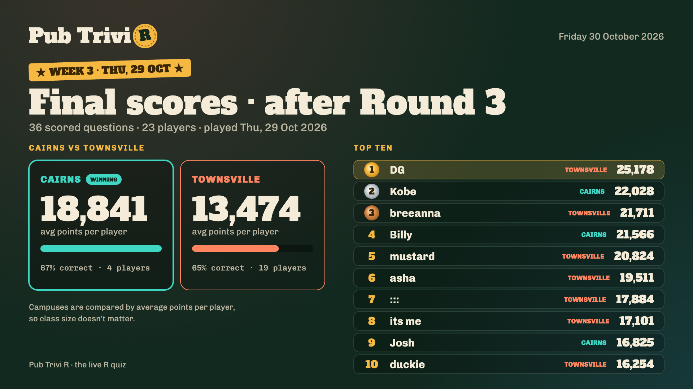
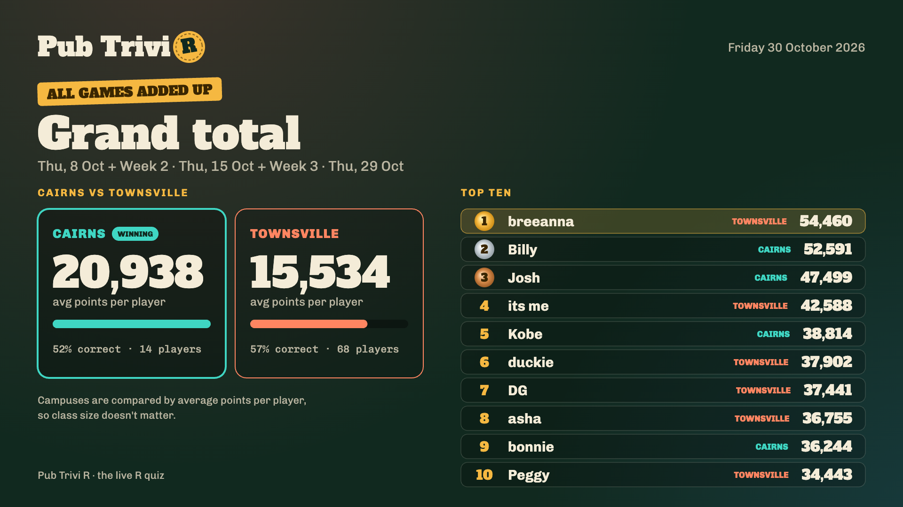

# Tutorial materials for SC1102 and SC1109

Welcome to the SC1102/SC1109 R Bootcamp. Here you will find all the materials required for the tutorial component of this section of the course.

You have just spent three weeks modelling population growth and fisheries data in Excel. Over the next three weeks you will learn to the same sorts of analyses in **R**. The goal is not to make you a programmer. It is to make you comfortable enough in R that when you reach the El Niño modelling section, you can spend your effort on the science rather than on the software.

Each week has three parts: a **one hour lecture**, a **two hour practical** (the tutorials below), and a **one hour synthesis session**.

## Before you start

You will need **R** and **RStudio** installed on your own machine before commencing Module 4. Detailed instructions for how to install R and RStudio can be found on the course website under Module 4.

## Pub TriviR update
Congratulations to everyone who participated in the third and final round of Pub TriviR for 2026! 

Despite leading for most of the round, **Kobe** was pipped at the post by a surging **DG** in a come from behind victory that no one could have seen coming! Taking up third place on the podium was Townsville's **breeanna** who, like a tortoise to DG's hare, was able to take out FIRST PLACE as the overall winner of the past three weeks! **Billy** and **Josh** rounded out the overall leaderboard bringing pride and glory to a Cairns team who also managed a crushing victory over Townsville for average overall points per player.

## Course Outline - SC1102

Module 4: [Welcome to R](SC1102_Tutorial_1/week_1.html)

Module 5: [Writing scripts and reproducibility](SC1102_Tutorial_2/week_2.html)

Module 6: [Building your own RMarkdown document](SC1102_Tutorial_3/week_3.html)

## Course Outline - SC1109

Module 4: [Welcome to R](SC1109_Tutorial_1/week_1.html)

Module 5: [Writing scripts and reproducibility](SC1109_Tutorial_2/week_2.html)

Module 6: [Building your own RMarkdown document](SC1109_Tutorial_3/week_3.html)

## Datasets

Module 4

- [fisheries.csv](SC1102_Tutorial_1/fisheries.csv) — 2000 synthetic catch records
- [fisheries.xlsx](SC1102_Tutorial_1/fisheries.xlsx) — the same data as an Excel workbook

Module 5

- [Paramecium_aurelia.csv](SC1102_Tutorial_2/Paramecium_aurelia.csv) - Paramecium population growth data

Module 6
- [recovering_fishery_counts.csv](SC1102_Tutorial_3/recovering_fishery_counts.csv) - Recovering fishery population counts
 
## Where this is going

By the end of Week 6 you will have written a short, complete report in RMarkdown, including text, code, tables and figures in a single document that anyone can re-run and get exactly your result.
